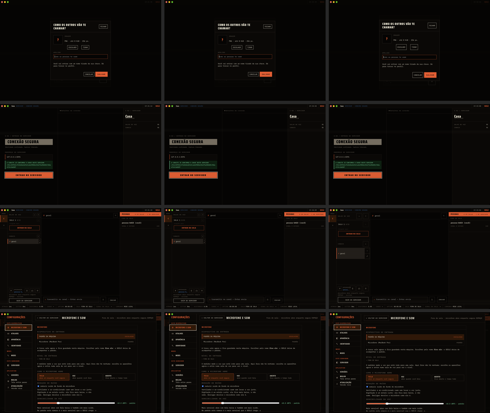

# O desktop não muda, no app de verdade (F8, Tarefa 16)

Medido em 09/10/2026, num Mac (macOS 27, WKWebView), com `cargo tauri dev` no
`0.16/celular` em `bc0e0bc4`, que já tem a `versao/0.16` (`adeb6960`).

## O que se comparou

O mesmo app, embutindo quatro `ui/` diferentes (`--config` com o `frontendDist`):

| rodada | a `ui/` |
|---|---|
| `antes` | a de hoje sem nenhum `celular-*` nem `larga-*`, e sem as linhas que os carregam |
| `depois` | a de hoje, com os arquivos das cascas do navegador (inertes sem a marca) |
| `pontos` | a `depois` com o P1 (a meta de viewport) e o P5 a P8, injetados como a bancada injeta |
| `revertido` | a `depois` com a regra dos 44 px **sem a marca**: a prova de que a comparação vê |

Em cada rodada, quatro telas, fotografadas da janela (`screencapture -l`):
- o apelido, que o app pergunta porque a identidade já existe e o perfil é novo;
- a entrada no servidor, pelo `--entrar`;
- a sessão;
- CONFIGURAÇÕES › MICROFONE E SOM.

Cada foto é aceita só com o tamanho exato da janela (2560 × 1600) e parada: uma
segunda foto, 1,2 s depois, difere em menos de 0,5 % dos pixels. Com o Stage
Manager ligado, a janela de um binário sem pacote fica na faixa do lado, e a
primeira tentativa fotografou a miniatura inclinada.

## O resultado

`antes` contra `depois` e contra `pontos`:

| tela | diferença | onde |
|---|---|---|
| apelido | 0,009 % | o relógio da barra; o cursor que pisca no campo |
| entrada | 0,007 % | o relógio |
| sessão | 0,010 % a 0,019 % | o relógio; o ATRASO medido (1 ms contra 0 ms) e o UPTIME |
| CONFIGURAÇÕES | 0 % | — |

Fora do relógio, do cursor, do ATRASO e do UPTIME, as telas são iguais pixel a
pixel. Com a meta de viewport e os pontos P5 a P8 no lugar, também.

`antes` contra `revertido`: de 0,1 % a 8,1 % dos pixels, em até 40 regiões (os
botões mais altos e a coluna da sessão deslocada). A comparação vê uma regra que
vaza.



## Isolamento

- `SEELE_HOME` numa pasta nova por rodada, e `SEELE_IDENTIDADE` numa pasta só
  desta prova: o perfil de quem usa a máquina (`~/.config/seele`) não foi
  tocado, e a cópia da linha legada da abertura não dispara.
- `SEELE_ENCONTRO=nao`, e o link `seele://127.0.0.1:8391/?fp=…` não leva
  bilhete: nada vai ao ponto de encontro.
- O atualizador sem `endpoints`: o `conferir_esta_versao` antes do `connect` não
  busca o `latest.json` no GitHub.
- Um `seeled` local em `127.0.0.1:8391`, de uma cópia do mesmo banco a cada
  rodada (o mesmo certificado e o mesmo estado).
- O `lsof` do processo do app, a cada meio segundo: nenhuma conexão TCP; só o
  socket UDP do cliente QUIC. O `lsof` não mostra o destino de um UDP não
  conectado; o que afasta o ponto de encontro é o `SEELE_ENCONTRO=nao`.
- O app e o servidor fecham no fim de cada rodada, dê certo ou não.

## O que fica de fora

- O **Windows (WebView2)**: não havia máquina.
- O **passo 1 do plano** (o G3 da bancada sem injeção nenhuma) espera os pontos
  entrarem no produto.
- A **CHAMADA**: abri-la pede uma sala de voz, e entrar numa sala no app de
  verdade abre o microfone, que pede a permissão do sistema.

## Como repetir

Os scripts esperam, na pasta deles: o `ax` (compilado de
`docs/evidencias/m3-custo-dos-mods/ax.swift`), o `srv0/` (um `seeled` que subiu
uma vez em `127.0.0.1:8391`; o `FP` do `rodar.py` é o certificado dele) e as
`ui/` de cada rodada numa pasta com o nome dela. A janela aparece na tela de
quem está na máquina e vem para a frente a cada foto: avise antes.

```bash
python3 rodar.py antes
python3 rodar.py pontos
python3 comparar.py antes pontos
```

Precisa das permissões de Acessibilidade e de Gravação de Tela já dadas ao
processo que roda (o `AXIsProcessTrusted` e o `CGPreflightScreenCaptureAccess`
dizem sem perguntar).
