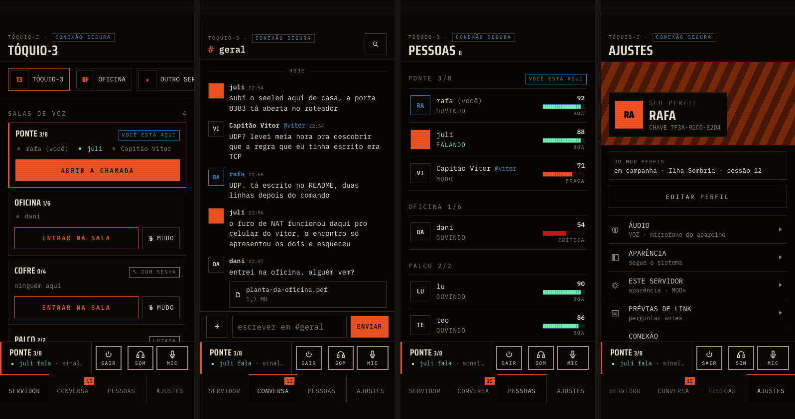
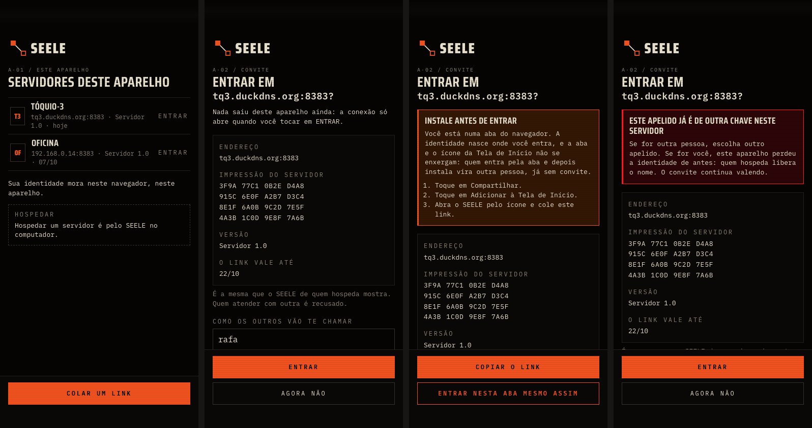
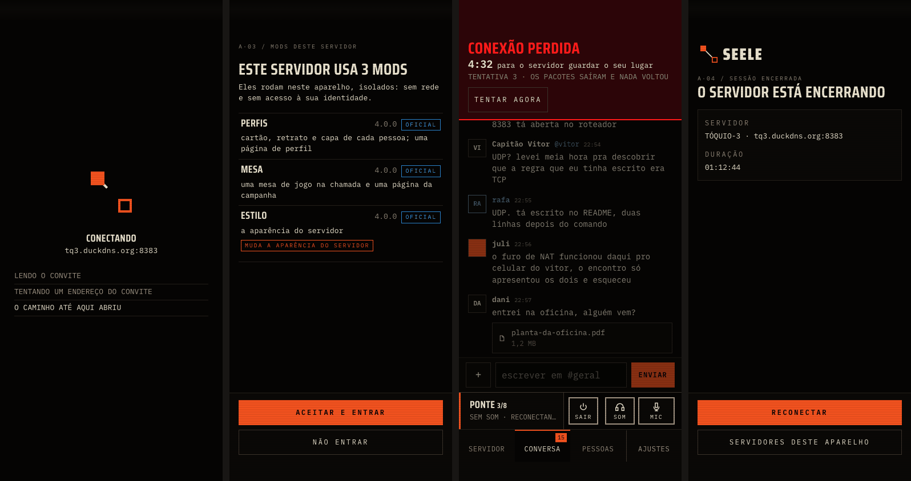
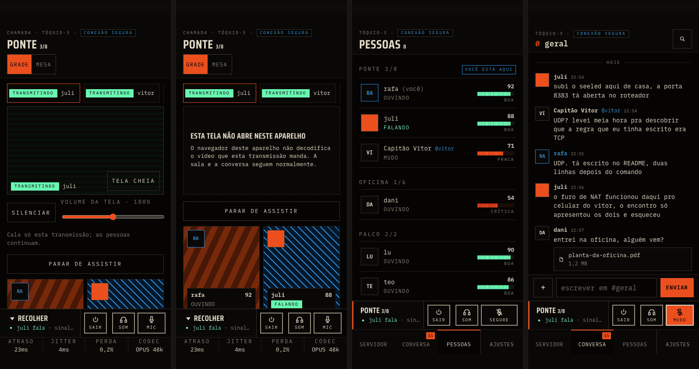
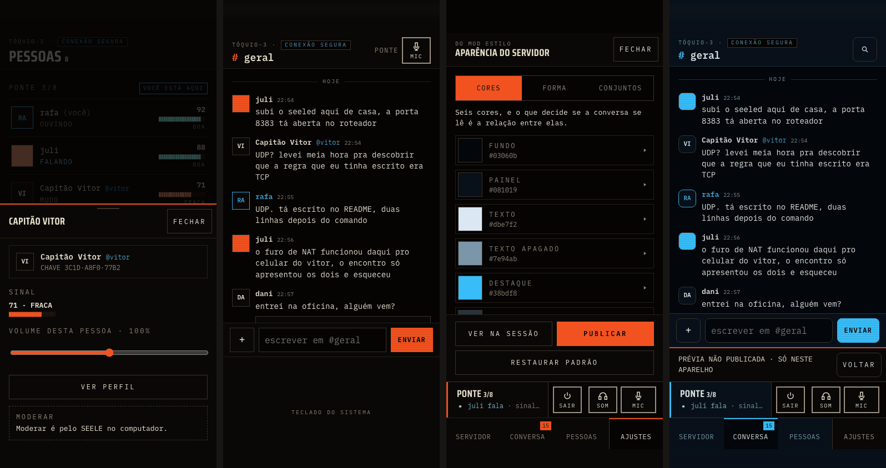
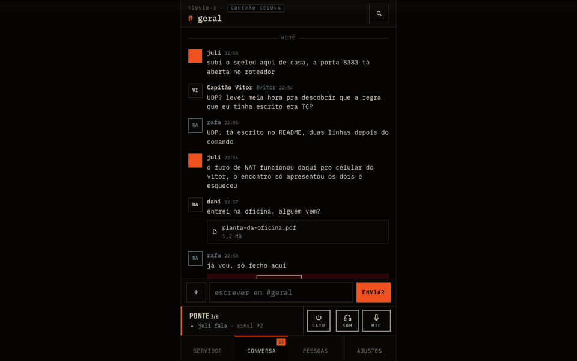
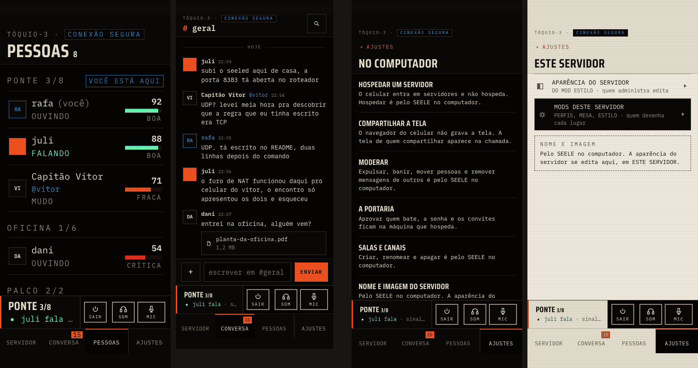
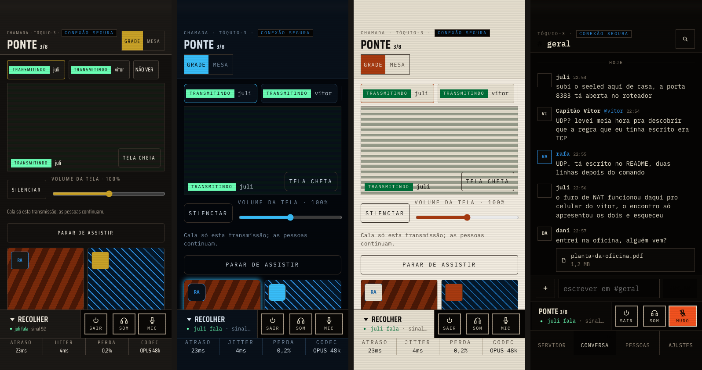

# A tela do celular: o desenho

> **Um desenho para uma mão, com a identidade do SEELE e a par do desktop.** São
> quatro abas no pé, na ordem das colunas do desktop: SERVIDOR · CONVERSA ·
> PESSOAS · AJUSTES. Acima delas, quando a pessoa está numa sala, fica a faixa de
> voz, com MUDO, SURDO e SAIR sempre à mão. Um toque na faixa abre a CHAMADA. O
> que o celular não faz é dito no lugar do controle e numa lista em AJUSTES.
>
> **Por baixo, a mesma casca.** Os desenhadores do desktop continuam desenhando,
> o celular reorganiza os nós com um CSS preso à marca `data-casca="celular"`, e
> a moldura nova aciona os controles que já existem. Nenhum `invoke` novo e
> nenhuma lógica duplicada.

**Data:** 2026-10-09. **Estado:** proposta para a revisão da orquestradora (Etapa A).
**Frente:** F8 da 0.16 (D-celular-1). **Branch:** `0.16/celular`, saído de
`versao/0.16` em `f7bc902b`. O publicado é a v0.15.1 (`54f542f94`), conferido
pela API de releases.

**Insumos:**
- o spec-mestre (`2026-10-08-0.16-design.md`, §2 F4 e F8, §3, §6 e §8);
- o ADR 0057, com as emendas de 08/10 e 09/10;
- o plano da F4 (Etapa 3);
- o rascunho da API 6 da F3, até `7ceae38`;
- os ADRs 0014, 0033, 0034 e 0054, a `specs/07-estetica.md`, a `docs/marca.md` e
  o `docs/glossario.md`;
- a revisão do celular de 05/10, de `arquivo/mobile-ios`, lida para não repetir
  os defeitos;
- a matriz de paridade (`sdd/2026-10-08-0.16/F8/paridade.md`, `e7ba0dd0`);
- as respostas da orquestradora de 09/10.

**O que acompanha:**
- o protótipo navegável, em `spikes/casca-do-celular/`;
- a prova da arquitetura sobre a casca de verdade, em
  `spikes/casca-do-celular/prova-sobre-a-casca/`;
- o plano, em `plans/2026-10-09-0.16-F8-celular.md`.

Marcas, como nos levantamentos: **[medido]** rodado aqui; **[c]** lido no código;
**[inf]** inferido; **[a medir]** ainda sem medida.

## A frase que este documento implementa

*A tela do mobile, com design e UX/UI, implementada até ficar a par do client
desktop: a mesma tipografia, as mesmas cores e o mesmo logo, mas algo novo, e não
uma cópia.* (o pedido do dono, 09/10)

Ficam de fora **o desktop encolhido** e **o merge da `celular.css`** de
`arquivo/mobile-ios`. Aquela casca dizia de si «não há uma casca de celular, há a
mesma casca numa tela estreita». Esta tem um desenho próprio. O que ela divide
com o desktop é o código que decide, e não a forma da tela.



---

## 1. Os princípios

1. **Uma mão.** O polegar alcança o que importa sem trocar a pegada.
   - O que se toca muito mora no terço de baixo: as abas, a faixa de voz, o
     compositor, as ações das folhas e o ENTRAR.
   - O alto da tela diz onde se está e quase não se toca. O que mora lá
     (BUSCAR, FECHAR de uma página de MOD, a volta de AJUSTES) é raro.
2. **A voz sempre à mão.** Dentro de uma sala, MUDO, SURDO e SAIR ficam visíveis
   em toda aba e em toda tela da sessão, sempre no mesmo lugar.
   - Nenhuma superfície de MOD os cobre.
   - A CHAMADA os mantém no mesmo x e y.
   - Com o teclado aberto, o MUDO vai para o topo.
   - Foi o defeito nº 1 da tentativa anterior: «na chamada não havia como sair
     da sala».
3. **O que o celular não faz, dito e não escondido.** Cada função de fora tem a
   frase no lugar do controle, só para quem o veria no desktop, e entra na lista
   NO COMPUTADOR em AJUSTES. A matriz tem as 92 frases.
4. **A identidade intacta.** O celular usa:
   - os tokens congelados (ADR 0014), sem nenhuma cor nova;
   - a Saira Condensed nas cartelas e a Plex Mono em todo dado;
   - canto reto e sem sombra;
   - a varredura;
   - o sinal por pessoa como elemento assinatura, com número, barra de blocos e
     palavra;
   - a voz da interface: fria, factual, sem primeira pessoa;
   - a marca, uma forma por tela (`docs/marca.md`, regra 2).
5. **A mesma informação.** O que o desktop diz, o celular diz: num lugar diferente,
   com outro tamanho, mas sem perder o dado. O que hoje só existe num `title` ou
   num hover vira texto visível ou folha, porque o celular não tem nenhum dos dois.

## 2. O mapa de telas e a navegação

### 2.1 A entrada



**O carregamento.** A página carrega as fontes, o `.wasm` e a identidade. É curto,
e não há tela de abertura própria. Enquanto a conexão abre, a tela de conectar mostra
a única animação da marca: o enlace se desenha do nó cheio ao vazio
(`docs/marca.md`, «O comportamento»). Ao lado, as etapas do `fraseDeEtapa` de hoje.
Ela dura o tempo da conexão.

**A tela de início** (o web app aberto sem link, o `start_url` do manifest):
- **SERVIDORES DESTE APARELHO**, cada um com o nome, o endereço, a versão do
  servidor, a última visita e ENTRAR. O ENTRAR é o ato explícito, então daqui se
  entra sem a tela «ENTRAR EM».
- **COLAR UM LINK**, que leva à «ENTRAR EM» sem conectar. O teclado só sobe com
  esse toque.
- A frase do hospedar no lugar do HOSPEDAR AQUI: «Hospedar um servidor é pelo SEELE
  no computador.»
- Vazia: «Nenhum servidor ainda. Abra um link de convite, ou cole um aqui.»

**«ENTRAR EM <endereço>?»** é a tela do link. O comportamento é da F4 (3.4); o
desenho é este.
- **Não mostra nome de servidor** antes de conectar (decisão da orquestradora):
  o nome seria só o que o link diz, e quem escreveu o link escolhe o que ele diz.
  Mostra o que se confere:
  - o **endereço**;
  - a **impressão do servidor inteira**, em mono, em dezesseis grupos de quatro,
    quatro por fileira, com a nota «É a mesma que o SEELE de quem hospeda mostra.
    Quem atender com outra é recusado»;
  - a **versão do servidor**;
  - **o link vale até DD/MM**.
- **COMO OS OUTROS VÃO TE CHAMAR**, já com o apelido deste aparelho. É a pergunta
  do desktop (`acbc1c29`), dentro da mesma tela. Não há caixa à parte, e o campo
  não pega o foco sozinho.
- A resposta do `navigator.storage.persist()` (ADR 0057), dita.
- **ENTRAR** e **AGORA NÃO**, no pé.
- Medido no protótipo: com o rótulo ao lado do valor, a impressão saía da tela a
  390. Por isso o rótulo vai em cima.

**Os estados da «ENTRAR EM»** (os nomes são os da F4; as frases, as da matriz):

| estado | o que a tela diz | as ações |
|---|---|---|
| `pronto` | o de cima | ENTRAR · AGORA NÃO |
| `numa-aba` | INSTALE ANTES DE ENTRAR: a aba e o ícone da Tela de Início não se enxergam, e quem entra pela aba e depois instala vira outra pessoa, já sem convite. Os três passos do Safari | COPIAR O LINK · ENTRAR NESTA ABA MESMO ASSIM |
| `vencido` | ESTE LINK VENCEU EM DD/MM, e peça um novo | SERVIDORES DESTE APARELHO |
| `servidor-0.15` | ESTE LINK É DE UM SERVIDOR 0.15: o celular entra só no Servidor 1.0 | idem |
| `incompleto` | LINK INCOMPLETO: sem a impressão e o certificado não há como conferir quem responde | idem |
| `outra-origem` | ESTE LINK É DE OUTRA PÁGINA DO SEELE: entrar por ela cria outra pessoa | idem |
| `ja-conhecido` | ESTE APARELHO JÁ ENTRA NESTE SERVIDOR, e o convite não é usado | ENTRAR · AGORA NÃO |
| `apelido-tomado` (desfecho do `entrar`) | ESTE APELIDO JÁ É DE OUTRA CHAVE NESTE SERVIDOR: se for outra pessoa, escolha outro; se for você, este aparelho perdeu a identidade e quem hospeda libera o nome. **O convite continua valendo** (a F1 confere antes do gasto) | o campo volta, vazio e marcado |

**Os desfechos que não são da «ENTRAR EM»** aparecem embaixo do ENTRAR, com as frases
de hoje. Uma exceção: o navegador não separa servidor fora do ar de chave trocada
(ADR 0057). Por isso as falhas de rede e de TLS viram uma frase só, «O SERVIDOR NÃO
ABRIU A CONEXÃO. Ele pode estar fora do ar, ou este link não é mais dele». A matriz,
na PA-53, lista as que ela junta.

**A espera da portaria** é a tela própria de hoje, numa coluna, com DETALHES DA
CONEXÃO recolhido. Ela diz que a espera pausa com a página oculta.

**O aceite de MODs** é tela cheia:
- ESTE SERVIDOR USA N MODS;
- «Eles rodam neste aparelho, isolados: sem rede e sem acesso à sua identidade»;
- cada MOD com o nome, a versão, OFICIAL quando for, o que ele faz, e a linha MUDA
  A APARÊNCIA DO SERVIDOR para o que tem a porta do tema;
- ACEITAR E ENTRAR e NÃO ENTRAR, no pé.

O sim fica no armazenamento da origem, pela ponte (F4).



### 2.2 A sessão

**A aba de chegada é a CONVERSA.** O desktop abre o primeiro canal de texto ao
entrar (`tela-auth.js`, PA-25 da matriz), e o celular abre esse mesmo canal. Quem
chega pela primeira vez vê a conversa do servidor, e as salas estão a um toque.

| aba | o que tem | de onde vem no desktop |
|---|---|---|
| **SERVIDOR** | a faixa deitada dos servidores deste aparelho (a `redes`, que rola de lado, com `+ OUTRO SERVIDOR`); SALAS DE VOZ, em cartões; CANAIS, com a contagem de novas; DOS MODS | a trilha, a coluna de salas e canais |
| **CONVERSA** | o canal aberto (topo com `# canal` e BUSCAR, mensagens, compositor), ou uma `pagina` de MOD | a coluna do meio |
| **PESSOAS** | as pessoas por sala, NO SERVIDOR (fora de sala) e **FORA DO AR**, apagado e sem horário | a faixa de pessoas |
| **AJUSTES** | SEU PERFIL com a capa, a região `operador.barra`, e as seções ÁUDIO, APARÊNCIA, ESTE SERVIDOR (aparência, MODs, CONEXÃO), PRÉVIAS DE LINK, ESTE APARELHO, NO COMPUTADOR e SOBRE, mais SAIR DO SERVIDOR | o operador e CONFIGURAÇÕES |

**O topo de cada aba** ocupa uma fileira. Em cima, num rótulo miúdo, o servidor e o
selo CONEXÃO SEGURA. Embaixo, o título da aba. O selo é do núcleo (§6).

**O cartão da sala:**
- o nome, `n/limite`, quem está dentro e quem fala;
- as marcas escritas **VOCÊ ESTÁ AQUI**, **COM SENHA** e **LOTADA**. Hoje o desktop
  não marca nem a senha nem a lotação (matriz, achado B-2);
- **ENTRAR NA SALA**, e ao lado **ENTRAR MUDO**. Fora de sala não há faixa de voz,
  e o áudio só abre ao entrar (D-52). Sem o ENTRAR MUDO, quem quer chegar calado
  entraria com o microfone aberto;
- numa sala LOTADA o ENTRAR continua, porque quem recusa é o servidor, como no
  desktop;
- numa sala com senha, o ENTRAR abre a folha SENHA DA SALA, no lugar do
  `window.prompt` do desktop;
- **entrar abre a CHAMADA**, como o desktop abre a grade ao entrar (matriz,
  B-C10), e RECOLHER volta à aba de onde se veio. A faixa de voz fica;
- a sala em que se está tem borda e barra do acento, e não o preenchimento laranja
  do desktop. Medido no protótipo: as cores de estado derivadas do tema caíam a
  3,8:1 sobre o tom fraco.

**A CONVERSA:**
- **o Return do teclado do sistema quebra fileira, e quem envia é o ENVIAR.** O Enter
  do desktop envia, e o Shift+Enter não existe num teclado virtual;
- o `+` abre a folha ANEXAR: FOTO OU VÍDEO, ARQUIVO, e as ferramentas dos MODs
  (`compositor.ferramentas`);
- **o toque numa mensagem abre a folha dela**: copiar, abrir o link com o destino
  escrito, salvar o anexo como download do navegador, reenviar ou descartar a
  própria que falhou, e apagar a própria. Remover a de outra pessoa fica fora, com a
  frase, só para quem modera;
- **o apelido verificado** fica ao lado do nome que um MOD desenha, em azul, a cor de
  identidade verificada (`specs/07`): «Capitão Vitor @vitor» (D-nucleo-1);
- a mensagem que não saiu fica numa placa vermelha própria, com REENVIAR (§6).

**PESSOAS:**
- cada linha tem o retrato, o nome (com o verificado ao lado), o estado em palavra
  (FALANDO, MUDO, SEM SOM, OUVINDO) e o sinal: número, a barra de 20 blocos da
  `blocos()` de `tela-sessao.js:209` e a palavra da faixa (BOA, FRACA, CRÍTICA);
- nada é dito só por cor (`specs/06`);
- o toque abre a folha da pessoa;
- **FORA DO AR** (D-fio-4) vem por último, apagado, sem horário e sem sinal. O
  desktop ainda não o desenha, porque o núcleo descarta `Membros` (matriz, achado
  B-7); o celular o desenha quando a F1 e a F5 o ligarem.

**AJUSTES:**
- **SEU PERFIL** no alto, com a capa animada do PERFIS por trás (D-capa-1) e o
  retrato, o apelido e a chave curta numa placa opaca. Embaixo, EDITAR PERFIL;
- a região **`operador.barra`** logo abaixo, com altura limitada e rolagem por
  dentro. A altura é um parâmetro que sai da M3 (F3);
- cada seção é uma página da própria aba, com «‹ AJUSTES» no topo;
- tocar de novo na aba AJUSTES volta à raiz.

**As seções de AJUSTES:**
- **ÁUDIO:** o modo (VOZ ou SEGURAR PARA FALAR), o microfone (o que o
  `navigator.mediaDevices` lista), a sensibilidade do VOZ e o medidor. Duas frases:
  a saída de som é escolhida pelo sistema, e o eco, o ruído e o ganho são os do
  navegador (ADR 0057, emenda ao 0007);
- **APARÊNCIA (pessoal):** segue o sistema. O contraste e o movimento são os do
  aparelho;
- **ESTE SERVIDOR:**
  - APARÊNCIA DO SERVIDOR, pelo ESTILO (§8);
  - MODS DESTE SERVIDOR: o que roda, quem desenha cada lugar, permissões e
    diagnóstico;
  - CONEXÃO: ATRASO, JITTER, PERDA, CODEC, CAMINHO, UPTIME e SINAL DA SALA, também
    fora de sala, que é onde o desktop mostra o rodapé;
  - nome e imagem só para leitura, com a frase de fora;
- **PRÉVIAS DE LINK;**
- **ESTE APARELHO:** a identidade, o armazenamento, instalar na Tela de Início e a
  versão da página;
- **NO COMPUTADOR:** a lista canônica, com 13 itens. As frases estão na matriz.

**PERDA, e não DISTÚRBIO.** É a palavra do glossário canônico, «Perda de pacote ·
perda». O rodapé do desktop ainda diz DISTÚRBIO.

### 2.3 A voz



**A faixa de voz** aparece só dentro de uma sala:
- **à esquerda, o que é tocável para abrir a CHAMADA:** a barra do acento, a sala e
  `n/limite`, e embaixo quem fala e o sinal da sala;
- **à direita, a placa do núcleo com SAIR · SURDO · MUDO.** O SAIR fica afastado,
  porque é o único que desfaz alguma coisa. O MUDO é o maior, por ser o mais tocado,
  e fica no canto do polegar direito;
- cada controle diz o estado em palavra embaixo do glifo: MIC ou MUDO, SOM ou SURDO;
- o desktop só diz isso no `aria-label` e no `title`.

**A CHAMADA** abre por um toque na faixa e cobre a sessão inteira:
- o topo: CHAMADA, o servidor, o selo, e o nome da sala grande;
- a escolha GRADE ou MESA, quando um MOD contribui `chamada.palco`;
- **o palco** da tela compartilhada (abaixo);
- **a grade** de cartões em duas colunas. Cada cartão tem a capa animada (D-capa-1),
  o retrato e uma placa opaca com o nome, o verificado, o sinal e o estado. Quem fala
  ganha um contorno de fósforo e a pastilha FALANDO;
- **embaixo, a mesma fileira da faixa, no mesmo x e y**. À esquerda dela, RECOLHER;
- **no lugar das abas**, a fileira de telemetria: ATRASO, JITTER, PERDA e CODEC.

**O palco: assistir com som (D-celular-2).** Compartilhar a própria tela continua em
NO COMPUTADOR.
- A fileira de escolha mostra cada transmissão da sala pela identidade dela (ADR
  0054), com a pastilha TRANSMITINDO e o nome, mais NÃO VER. Assiste-se a uma por
  vez.
- Embaixo da imagem: SILENCIAR, com a nota «Cala só esta transmissão; as pessoas
  continuam.», o VOLUME DA TELA na largura toda (0–200 %), PARAR DE ASSISTIR, e TELA
  CHEIA, que também abre ao deitar o aparelho.
- **Se o aparelho não decodifica a tela** (o H.264 High no iPhone está por medir), o
  lugar do palco fica, com «ESTA TELA NÃO ABRE NESTE APARELHO. O navegador deste
  aparelho não decodifica o vídeo que esta transmissão manda. A sala e a conversa
  seguem normalmente.».
- O som e o leitor do fluxo são da F4.

**SEGURAR PARA FALAR** é a adaptação do modo TECLA (orquestradora, 09/10):
- o MUDO vira um botão mais largo, SEGURE, que só fala enquanto o dedo está nele e
  diz NO AR;
- **ele fecha sozinho** em `touchcancel`, quando o dedo sai do botão, quando a página
  fica oculta e quando a sessão cai. Cada caso tem um teste;
- se o modo falhar, ele falha calado, e nunca com o microfone preso aberto;
- o VOZ é o padrão;
- com a tela bloqueada só o VOZ fala, e AJUSTES › ÁUDIO diz isso.

**Com o teclado aberto**, as abas saem e a faixa se recolhe no topo da CONVERSA, como
o nome da sala e o MUDO. O compositor fica colado ao teclado, pela altura que o
`visualViewport` dá.

### 2.4 As folhas

Folhas de baixo para:
- a pessoa: o sinal com palavra, o VOLUME DESTA PESSOA (que no desktop só aparece no
  hover), VER PERFIL e MODERAR, que fica fora, com a frase e só para quem modera;
- a mensagem;
- anexar;
- a senha de sala;
- a confirmação, que substitui a caixa `#moderar` em todos os usos de consumo:
  trocar de servidor, salvar anexo e «FECHAR SEM GRAVAR?» dos MODs.

Toda folha tem FECHAR no cabeçalho, e o voltar do Android também fecha. A
confirmação tem a borda vermelha e o verbo inteiro no botão, como no desktop.



### 2.5 Os alertas

- **A queda não fecha a tela** (`specs/07`). Ela é uma faixa sobre a sessão, com:
  - CONEXÃO PERDIDA;
  - a contagem dos cinco minutos em que o servidor guarda o lugar;
  - a tentativa e a última falha;
  - TENTAR AGORA.

  A sessão esmaece e continua legível. A faixa de voz diz «SEM SOM · RECONECTANDO».
- O **alerta** (`#banner`), o **veredito** e os **avisos de MOD** aparecem em largura
  cheia. Os avisos de MOD ficam acima da faixa e das abas, em fila.
- **O aviso de fone muda de frase.** O de hoje, «O SEELE ainda não cancela eco», é
  falso no navegador, onde o eco do navegador está ligado (matriz, achado E-6). Vai
  para `AVISO_DE_FONE_CELULAR`.
- A **faixa de quem bate à porta** não existe no celular. O número de pendentes só
  existe no banco de quem hospeda, e o celular nunca hospeda.

### 2.6 O fim

É a tela de fim de hoje, em tela cheia, por cima das abas e da faixa. Tem o motivo
do `MOTIVOS`, RECONECTAR (com o nome do servidor) e SERVIDORES DESTE APARELHO. Com
os hashes guardados vencidos, o RECONECTAR leva ao `vencido`.

### 2.7 Voltar

- Cada folha, subpágina e a CHAMADA empurram um estado no `history`. O voltar do
  Android e o gesto de borda do iOS fecham o que estiver por cima, um por vez.
- Nada fecha por toque fora, a não ser o véu de uma folha.
- **Recarregar derruba a sessão.** No navegador ela vive na página. A raiz não puxa
  para recarregar (`overscroll-behavior: none`), e cada painel rola dentro de si. O
  desktop bloqueia o F5 pela mesma razão (`base.js:326-380`).

## 3. Os componentes novos e os tokens

Nenhuma cor nova. As medidas de layout moram na folha do celular, como
`--seele-barra-janela` mora em `base.css`, e não em `tokens.css`, que é congelado.

| componente | o que é | tokens |
|---|---|---|
| **abas** | 4 colunas de `minmax(0, 1fr)`, 56 px mais a área segura de baixo; rótulo de 12 px com teto de 13 px (abaixo); a ativa tem a barra de 2 px do acento | `--seele-negro-painel`, `--seele-rotulo-painel`, `--seele-osso`, `--seele-laranja-nerv`; a aba AJUSTES usa `--nucleo-*` (§6) |
| **faixa de voz** | 64 px; a sala à esquerda, e a placa do núcleo à direita com SAIR, SURDO e MUDO | a superfície do tema; a placa e os controles em `--nucleo-*` |
| **topo da aba** | 56 px mais a área segura de cima; o rótulo miúdo com o selo, e o título | `--seele-t-titulo` (28) em Saira, ou `--seele-t-secao` em mono para o `# canal` |
| **selo da conexão segura** | o selo, numa placa | `--nucleo-seguro` (azul), `--nucleo-fundo` |
| **cartão de sala** | painel com borda; a sala em que se está tem a barra do acento | `--seele-negro-painel`, `--seele-linha`, `--seele-laranja-nerv` |
| **linha de pessoa** | 64 px: retrato de 40, nome e estado, e o sinal (número, 20 blocos, palavra) | `--seele-sync-*` derivados (§6) |
| **cartão da chamada** | 4:5, capa por trás, placa opaca com o texto | a capa é conteúdo de MOD; a placa é `--seele-negro-painel` |
| **folha** | ancorada embaixo, até 85 % da altura; véu `--seele-negro-absoluto` a 72 % (opacidade de um token, como a varredura); borda de cima do acento | `--seele-negro-painel`, `--seele-laranja-nerv`; confirmação com `--seele-vermelho-alerta` |
| **ficha** | o rótulo em cima do valor; a impressão em grupos de 4 | `--seele-t-dado` |
| **placa de alerta** | o vermelho sempre sobre o vermelho-fraco | `--nucleo-alerta`, `--nucleo-alerta-fundo` |
| **o que fica fora** | caixa com borda tracejada, o rótulo do controle e a frase | `--seele-linha-forte` |

**Os tamanhos.**
- O corpo é `--seele-t-corpo` (14 px). O desktop usa 13.
- O rótulo é o `--seele-t-rotulo` de 12 px (U04). A coluna densa do desktop desce a
  10.
- **Um campo tem 16 px de letra** (`--cel-campo`): abaixo disso o iOS amplia a
  página ao focar. Não é token de desenho. É a mesma natureza de
  `--seele-barra-janela`.
- **Todo controle tem pelo menos 44 × 44** (`--cel-alvo`).

## 4. O movimento

**Corte seco**, como a `specs/07` manda (decidido em 09/10):
- folhas, a CHAMADA e as subpáginas aparecem, e não deslizam;
- uma folha só acompanha o dedo enquanto é arrastada, e isso é resposta ao gesto, e
  não transição. Ela não tem animação de assentar.

O que se move:
- **o enlace da marca enquanto conecta**: a única animação da marca;
- **o diagnóstico**: o pulso de quem fala, a barra do sinal e a contagem da queda;
- **a varredura**, a exceção nomeada da `07`, igual à do desktop. O custo de bateria
  dela entra na medida de 30 minutos da F4 **[a medir]**;
- **a capa animada** (D-capa-1): é conteúdo, e não transição. Tem o mesmo teto de
  capas animadas do desktop e o quadro parado sob movimento reduzido (§8).

Com **`prefers-reduced-motion: reduce`**, a `acessibilidade.css` de sempre, carregada
por último, desliga tudo: o enlace fica inteiro e parado, a varredura estaciona, e as
capas mostram o quadro estático.

## 5. O aparelho

**As áreas seguras.**
- A meta de viewport leva `viewport-fit=cover`. As quatro áreas passam por
  variáveis (`--cel-seguro-*`, lidas de `env(safe-area-inset-*)`): o topo desconta a
  ilha, as abas e a CHAMADA descontam a barra de gestos, e o deitado desconta os
  lados.
- A meta **não** leva `user-scalable=no`: a pinça continua para quem precisa dela.
- `touch-action: manipulation` tira só o zoom de toque duplo, que acontecia com MUDO
  e SURDO tocados em seguida.
- O Chromium não tem área segura, por isso a auditoria do protótipo injeta as
  medidas de um iPhone (59/34) e de um Android (24/24) nas variáveis.

**O teclado do sistema.**
- O compositor fica colado ao teclado, pela altura do `visualViewport`.
- Com o teclado aberto, as abas saem e o MUDO vai para o topo.
- Nenhum campo pega o foco sozinho ao abrir uma tela. A tentativa anterior focava o
  endereço e levantava o teclado.
- O diálogo e a folha de MOD sobem com o teclado: o campo com foco nunca fica
  embaixo dele (rascunho da F3, §5).

**A orientação.**
- Em pé é a casa.
- Deitado, a CHAMADA põe o palco em tela cheia, e o resto mantém a coluna central.

**Uma tela larga.** A marca `data-casca` quer dizer «navegador», então um notebook
com o web app recebe esta casca. Ela fica numa **coluna centralizada de até 480 px**,
com as abas presas a ela e borda dos dois lados, sem esticar. Quatro abas de 350 px
para uma palavra de oito letras não servem a ninguém.



**Os alvos.** São 44 × 44 em todo controle tocável, medidos em 31 estados, 2 tamanhos
e 4 temas **[medido]**. A exceção é o texto corrido com link.

**VoiceOver e TalkBack.**
- Cada aba é um `button` com `aria-current="page"`, num `nav` rotulado.
- A faixa de voz é uma `section` rotulada «Sala de voz <nome>». O MUDO e o SURDO
  têm `aria-pressed` e um rótulo que diz o estado e o efeito («Microfone aberto.
  Tocar fecha.»).
- As folhas têm `role="dialog"` e `aria-modal`, prendem o foco, e o devolvem a quem
  as abriu.
- As regiões vivas de hoje continuam (`#anuncio`, `#banner`, `#veredito`). A troca de
  aba se anuncia. A contagem da queda anuncia só os marcos.
- **[a medir]** Nada disso rodou num leitor de tela.

**O texto dinâmico.**
- O iOS só entrega o tamanho que a pessoa escolheu pela fonte `-apple-system-body`.
  A casca mede uma vez e escala a escala de tipo do produto inteira pela razão com
  17 px, sem trocar de família, entre 1 e 2 (`--cel-escala`).
- No Android, o ajuste de texto do Chrome age sobre os px.
- **As abas têm teto de 13 px**, como a barra de abas do iOS. Medido a 150 %: 106 px
  de texto em 98 de aba, uma sobre a outra. O conteúdo das abas cresce sem teto.
- Os títulos quebram fileira, e não cortam. Medido: as reticências engoliam a
  CONEXÃO SEGURA a 150 %.
- **[a medir]** A `-apple-system-body` no Safari 27 e no web app instalado.



## 6. O tema do servidor e o núcleo

**O tema alcança tudo**, como o dono pediu e a orquestradora aprovou. Os `--seele-*`
são escritos em `#tela-sessao` (`base.js:2096`), e o celular mora inteiro dentro dele.

**O núcleo é estrutural.**
- As cores do núcleo são variáveis `--nucleo-*` **declaradas na raiz a partir dos
  tokens**. Um `var()` resolve onde a variável é declarada e desce resolvido, então
  o tema escrito em `#tela-sessao` não as alcança.
- A lista que o tema escreve é fechada, com 11 nomes `--seele-*`, e **nenhum começa
  com `--nucleo-`** (confirmado por uma sonda sobre as quatro tabelas de `base.js`,
  matriz §7). O guarda disso é da F8.
- **O que lê o núcleo, com fundo e borda opacos do núcleo:**
  - **MUDO, SURDO e SAIR**, numa placa do núcleo;
  - **o selo da conexão segura**. No desktop ele mora na barra da janela, fora do
    tema;
  - **a saída do tema:** a aba AJUSTES, a linha MODS DESTE SERVIDOR e a página
    dela. No desktop, CONFIGURAÇÕES é filho de `body` e o tema não chega lá; no
    celular, AJUSTES é aba da sessão. Um tema ilegível não pode fechar a porta de
    sair dele;
  - **a placa de alerta**: o vermelho fica fora de todo caminho de tema (F3, §9),
    então ele mora sobre o vermelho-fraco, e nunca sobre o painel temado.
- **Por que uma placa, e não uma cor de borda.** A WCAG pede 3:1 entre o contorno de
  um controle e o que está em volta. Nenhuma cor única alcança 3:1 contra qualquer
  fundo que um tema escolha **[medido]**: a `linha-forte` sobre o painel dava 1,59:1
  já sem tema, e a borda do MUDO apertado sob um painel claro, 1,01:1. Sobre a
  placa, a borda é medida contra uma cor que o tema não toca.

**Medido no protótipo** [medido], nos 5 temas: sem tema, PAPEL e PROFUNDO do ESTILO,
o **hostil** do §8 do spec-mestre (acento `#050403`) e um **claro** que passa em
todos os pares da API 6:

| controle | texto sobre o fundo dele | borda contra a placa |
|---|---|---|
| MUDO apertado | 5,85:1 | 15,99:1 |
| MUDO solto, SURDO, SAIR | 15,6:1 | 6,99:1 |
| selo da conexão segura | 5,98:1 | — (é rótulo) |

**A cor computada desses controles é a mesma nos cinco**, cor por cor, e a auditoria
reprova se mudar.



**Dentro da sessão, o texto secundário é `--seele-rotulo-painel`**, que é o
«apagado» do tema. O `--seele-rotulo-claro` é o rótulo das camadas fora do tema, e
sobre o painel de um tema claro ele dava 2,21:1 **[medido]**.

**As cores de estado são derivadas do tema** (F3, §9, decidido em 09/10). O fósforo,
o azul e as faixas do sinal mantêm o matiz e movem a luminosidade até 4,5:1 sobre o
`fundo` e sobre o `painel`. O tema padrão reproduz os tokens com ΔE ≤ 2.
- **A função é a da F3, na tarefa 17e.** O protótipo tem uma provisória no mesmo
  lugar (`derivarEstado`, em `prototipo.js`), que será trocada.
- O «juli fala» sobre um painel claro é o caso de prova. Sem a derivação dava
  1,05:1; com a provisória, passa.

**A auditoria do contraste** mede todo texto visível contra o fundo opaco de
verdade atrás dele: 4,5:1, ou 3:1 para texto grande.
- Nos temas sem tema, PAPEL, PROFUNDO e claro, ela passa em todos os 31 estados.
- No hostil ela mede só o núcleo: a API 6 recusa esse tema pelos pares, e o celular
  só fala a 6.

## 7. Os MODs no celular

As regiões e superfícies moram assim. O contrato é da F3, e o rascunho dela já tem
esta tabela, até `7ceae38`:

| região · ponto · superfície | no celular | o que a F3 decidiu |
|---|---|---|
| `redes` | a faixa deitada dos servidores, no alto da aba SERVIDOR | — |
| `servidor.navegacao`, `canal.item`, `sala.acoes` | a aba SERVIDOR; o `sala.acoes` sai das pessoas e vai para o cartão da sala, com ações de 44 | `listarNaBarra: false` vale aqui |
| `operador.barra` | **logo abaixo de SEU PERFIL**, com altura limitada e rolagem por dentro; nenhuma contribuição cobre a gestão de MODs | **aceito**; o `regiao-ausente` fica no contrato para a casca que não tiver a região. O passo 8b da F3 o testa sobre esta casca |
| `canal.cabecalho` | o topo da CONVERSA, numa fileira de 44 abaixo do `# canal` | — |
| `conversa.mensagem`, `pessoa.avatar` | cada mensagem; o avatar também na aba PESSOAS e na folha da pessoa | — |
| `compositor`, `compositor.ferramentas` | a folha ANEXAR, em DOS MODS | — |
| `pessoas.lista`, `pessoa.identidade`, `pessoa.cartao`, `pessoa.detalhes`, `pessoa.acoes` | a aba PESSOAS e a folha da pessoa; o `pessoa.detalhes` sempre tem lugar na folha | o verificado à vista (D-nucleo-1) |
| `pessoa.capa` | o cartão da CHAMADA e o cabeçalho SEU PERFIL, **nunca** a faixa de voz | a capa do operador pinta SEU PERFIL (§4 corrigido em `7ceae38`) |
| `status.barra` | a fileira de telemetria da CHAMADA | — |
| `servidor.aparencia` | AJUSTES › ESTE SERVIDOR | a porta de quem vê sobre o tema |
| `chamada.palco` | vista alternativa à grade, dentro da CHAMADA (GRADE · MESA) | o palco escondido continua montado, e o som também |
| `pagina` | o lugar da CONVERSA; a imersiva cobre o conteúdo, e nunca a faixa nem as abas | **no núcleo do contrato** |
| `folha` | folha de baixo, acima da faixa e das abas | idem |
| `dialogo` | tela cheia **acima da faixa e das abas**, com as ações fixas embaixo | idem; **a faixa e as abas nunca ficam inertes**: o foco do teclado fica preso no diálogo, mas o toque no MUDO, no SAIR e em AJUSTES chega ao produto (exceção ao ADR 0052 no celular) |
| `aviso` | acima da faixa e das abas, em fila | — |
| a faixa `#regioes-dos-mods` | não existe: sai com a capacidade `regiao` | — |

**Por que nenhuma superfície de MOD cobre a faixa.** Achado no protótipo: o diálogo
do ESTILO em tela cheia cobria o MUDO e o caminho para AJUSTES, que é o único jeito
de desligar um MOD no celular. A solução é estrutural. O palco dos MODs ocupa só o
topo e o painel da grade da sessão, e uma superfície montada lá não tem como chegar
à faixa.

**A saída de cada superfície tem 44.** No desktop ela tem 28 px
(`mods-superficies.css:347`).

## 8. As decisões do dono, no desenho

| decisão | onde |
|---|---|
| **D-capa-1**: a capa animada na chamada e nos dois cabeçalhos do perfil, com o mesmo teto | o cartão da CHAMADA e SEU PERFIL; o cabeçalho do perfil do PERFIS é uma `pagina` dele. O texto do produto fica em placas opacas, e a capa aparece em volta (§4 do rascunho). O teto de capas animadas é o do desktop, e as que passam dele, as fora da vista e as sob movimento reduzido mostram o quadro parado |
| **D-nucleo-1**: o apelido verificado sempre à vista | ao lado do nome de MOD, em azul, na mensagem, na linha de pessoa, no cartão da chamada e na folha da pessoa. Ele não aparece duplicado quando o MOD não trocou o nome |
| **D-estilo-1**: a aparência editável numa coluna, em tela cheia e com «ver na sessão» | AJUSTES › ESTE SERVIDOR › APARÊNCIA DO SERVIDOR abre o diálogo do ESTILO acima da faixa e das abas, numa coluna (as seis cores empilhadas), com as abas CORES · FORMA · CONJUNTOS cabendo em 390 e as ações fixas embaixo: VER NA SESSÃO, PUBLICAR e RESTAURAR PADRÃO (com a confirmação do produto). **VER NA SESSÃO** recolhe o diálogo num selo, «PRÉVIA NÃO PUBLICADA · SÓ NESTE APARELHO», acima da faixa de voz, com VOLTAR, e a sessão aparece com a prévia. O selo é do núcleo. A prévia pertence à superfície (§9 do rascunho) |
| **D-52**: o áudio abre só ao entrar numa sala | a faixa de voz só existe dentro da sala. ENTRAR NA SALA e ENTRAR MUDO abrem o áudio, e SAIR o fecha. Na entrada não há pergunta de microfone. O navegador pede a permissão no primeiro ENTRAR NA SALA, e a recusa tem frase própria |
| **D-web-1**: os MODs rodam no celular | o aceite (§2.1) e as regiões (§7). O executor é o da F4 |
| **D-celular-2**: assistir à tela com som | o palco (§2.3) |

## 9. A arquitetura do código

### 9.1 A escolha: híbrida (aprovada em 09/10)

| alternativa | o que custa | por que não |
|---|---|---|
| reestilizar a casca inteira pelo CSS (a `celular.css` antiga) | pouco código | é o desktop encolhido: a moldura do desktop (operador, trilha, rodapé) não tem forma para uma mão |
| desenhadores próprios do celular | liberdade total de marcação | duplica o desenho de cada lista, e a paridade se perde a cada lote da F5 |
| **híbrida**: os desenhadores de hoje para o conteúdo, a moldura nova para o celular | a moldura e os pontos de extensão | **escolhida** |

Ficam nos módulos de hoje:
- **o estado:** o `snapshot`, a sessão e a geração;
- **os `invoke`**: o celular não chama nenhum diretamente;
- **as frases:** todas no `frases.js`, com as do celular num bloco próprio;
- **as regras:** quem pode o quê, as faixas do sinal, a `blocos()`, o aceite.

O que muda é a apresentação e a navegação.

### 9.2 Como a casca é escolhida

A marca `data-casca="celular"` sai da **`ponte-web.js` da F4**, de forma síncrona, no
primeiro script do `<head>` (decisão da orquestradora).
- O `invoke("plataforma")` é assíncrono, e a CSP do pacote proíbe script inline.
- A marca quer dizer «navegador». Um notebook com o web app também a recebe (§5).
- O `plataforma` continua respondendo `"web"`, para quem o lê.
- No app desktop não há ponte, e a marca não existe.

### 9.3 Os arquivos novos

Todos em `apps/seele-app/ui/`, liberados com a revisão:

| arquivo | o que faz |
|---|---|
| `celular-base.css` | a raiz do celular: as medidas, o `--nucleo-*`, as áreas seguras, a escala do texto, a tela larga |
| `celular-sessao.css` | a sessão em abas: o topo, os painéis do desktop reorganizados, as abas, a faixa de voz, a CHAMADA |
| `celular-folhas.css` | as folhas, a confirmação, o palco dos MODs e as superfícies acima da faixa |
| `celular-entrada.css` | a tela de início, a «ENTRAR EM», a espera, o aceite e o fim |
| `celular-casca.js` | a montagem da moldura, as abas, o `history` e a medida do texto do sistema; inerte sem a marca |
| `celular-voz.js` | a faixa de voz e a CHAMADA: acionam os controles do desktop; o SEGURAR PARA FALAR, com o fechar sozinho |
| `celular-folhas.js` | as folhas (pessoa, mensagem, anexar, senha, confirmação) |
| `celular-entrada.js` | o desenho da tela de início e da «ENTRAR EM», sobre o contrato da `identidade-web.js` |
| `celular-ajustes.js` | AJUSTES: SEU PERFIL, as páginas, CONEXÃO, ESTE APARELHO e NO COMPUTADOR |

### 9.4 Os pontos de extensão, um a um

São o que a orquestradora libera quando a F5 fechar as ondas 5 e 6. Em cada um, o
padrão é o comportamento de hoje, e o desktop não muda.

| id | arquivo | o que entra | o desktop |
|---|---|---|---|
| **P1** | `index.html`, `<head>` | `<meta name="viewport" content="width=device-width, initial-scale=1, viewport-fit=cover">` | **igual pixel a pixel no Chromium** [medido]. A conferir no WebView2 e no WKWebView, que ignoram a meta numa janela de desktop [inf] |
| **P2** | `index.html`, `<head>` | os `<link>` de `celular-*.css`, depois de `tela-auth.css` e antes de `acessibilidade.css` | sem a marca, nenhuma regra casa (guarda G1) |
| **P3** | `index.html`, fim do `<body>` | os `<script>` de `celular-*.js`, depois de `tela-auth.js` | inertes sem a marca (guarda G4) |
| **P4** | `index.html`, dentro de `#tela-sessao` | a marcação da moldura, `hidden`: a faixa de voz (`#voz`, `#voz-mudo`, `#voz-surdo`, `#voz-sair`), as abas (`#cel-aba-servidor` … `#cel-aba-ajustes`: o prefixo `cel-` não é decoração, e o `tokens.rs` lê `#aba` como uma cor hexadecimal de três dígitos), o palco dos MODs, o lugar das folhas e o selo | `hidden` (`[hidden] { display: none !important }`, `base.css`) |
| **P5** | `base.js` | `const CASCA = Object.seal({ depoisDeDesenhar: [], pedirSenhaDaSala: async () => window.prompt("Senha da sala"), enterEnvia: true, avisoDeFone: () => AVISO_DE_FONE })` | os padrões são o de hoje |
| **P6** | `tela-sessao.js`, fim de `desenhar(snapshot)` | `for (const f of CASCA.depoisDeDesenhar) f(snapshot);` | a lista está vazia. Provado sobre a casca [medido] (§9.6) |
| **P7** | `tela-sessao.js`, `alternarCanal` (`:3456`) | `await CASCA.pedirSenhaDaSala(nome)` no lugar do `window.prompt` | o mesmo `prompt` |
| **P8** | `tela-sessao.js`, o Enter que envia (`:4108`) | `if (!CASCA.enterEnvia) return;` | `true` |
| **P9** | `tela-sessao.js`, o aviso de fone (`:313-347`) | `CASCA.avisoDeFone()` | a frase de hoje |
| **P10** | `frases.js` | um bloco `FRASES_DO_CELULAR` com as frases novas da matriz, e o `AVISO_DE_FONE_CELULAR` | não é lido |

**O que não precisa de ponto de extensão.** As ações da voz acionam os controles que
já existem: `#botao-mudo`, `#botao-surdo`, `#operador-sair` com `dataset.alvo ===
"sala"` e `segurarFala(segurando)` (`tela-sessao.js:3550`). Provado sobre a casca
[medido]: o MUDO da faixa manda `set_muted {on: true}` pelo `#botao-mudo`.

**A conferir na tarefa de AJUSTES.** Se as seções de `#tela-server` (uma camada,
filha de `body`) se deixam mostrar como páginas da aba sem um ponto em
`tela-server.js`. A prova não cobriu isso, e o plano tem a tarefa com o critério.

**Da F4, e não da F8:** `base.js:36-37` (a ponte no lugar do `__TAURI__`), a
`ponte-web.js`, a `voz-web.js`, a `identidade-web.js` e a `mods-no-navegador.js`.

### 9.5 Como o desktop fica sem nenhuma mudança visível

- **G1.** Toda regra de `celular-*.css` começa pela raiz `:root[data-casca="celular"]`,
  inclusive dentro de `@media`.
- **G2.** Nenhum CSS do desktop cita `data-casca`.
- **G3.** A sessão do desktop, com os arquivos do celular carregados e sem a marca, é
  **igual pixel a pixel** à de antes. O relógio e o uptime ficam mascarados, e o
  movimento reduzido para a varredura. Isso já roda na prova [medido], e vira
  bancada.
- **G4.** Os `celular-*.js` não fazem nada no topo além de registrar, e a primeira
  linha confere a marca.

### 9.6 A prova sobre a casca

`spikes/casca-do-celular/prova-sobre-a-casca/prova.py` roda contra a `ui/` de hoje,
por uma cópia, como o `tools/carga-da-casca.py` [medido, 09/10]:

1. **o desktop não muda:** com o CSS e o JS do celular e a meta de viewport, sem a
   marca, a sessão a 1440 × 900 é **igual pixel a pixel** à da `ui/` sem eles;
2. **a aba PESSOAS sai da lista do desktop:** a `#lista-roster`, desenhada pelo
   `tela-sessao.js` de sempre, aparece com 4 pessoas e 390 px. **Sem a meta de
   viewport, ela sai com 980 px**, e a prova reprova. É por isso que o P1 existe;
3. **o MUDO da faixa aciona o caminho de sempre:** o toque manda `set_muted {on:
   true}`, e a faixa se redesenha pelo gancho do P6, injetado só na cópia.

### 9.7 Os guardas

| guarda | onde | o que prova |
|---|---|---|
| G1, G2 | `tests/celular.rs` (novo) | o escopo do CSS (§9.5) |
| G3 | bancada Playwright | o desktop igual pixel a pixel |
| G4 | `tests/celular.rs` | o `celular-*.js` inerte sem a marca |
| **G5** | `tests/celular.rs` | **nenhum `invoke(` em `celular-*.js`**: as ações passam pelo que já existe, e «nenhum `invoke` novo» deixa de ser promessa |
| **G6** | `tests/celular.rs` | as regras de `#voz-mudo`, `#voz-surdo`, `#voz-sair`, `.voz-controles`, do selo, da aba AJUSTES e da linha dos MODs só leem `--nucleo-*` |
| **G7** | `tests/celular.rs` | nenhum valor de `TEMA_DA_API`, `NUMEROS_DA_API`, `BANDEIRAS_DA_API` ou `MEDIDAS_DA_API` começa com `--nucleo-` |
| G8 | bancada Playwright | o contraste computado do núcleo sob os acentos `#331704`, `#050403` e `#0a0806` e o tema claro, igual ao nativo e ≥ 4,5:1 e 3:1. É o guarda do passo 3 da Tarefa 3.5 |
| G9 | bancada Playwright | o SEGURAR PARA FALAR fecha nos quatro casos: `touchcancel`, dedo fora, página oculta e queda |
| G10 | bancada Playwright | a auditoria do protótipo sobre a casca: alvos de 44, nada rola de lado, nada na ilha nem na barra, texto dentro da caixa, contraste de todo texto, nos estados principais, a 390 e a 360 |
| existentes | `tests/frontend.rs`, `tests/tokens.rs`, `nenhum_innerhtml_na_casca` (F4) | `scripts()` já lê o diretório, e lê os novos. O `styles()` lê só o que a `index.html` liga, e o P2 os liga. O `tokens.rs` já lê todo `.css` do diretório, e o guarda da ordem das folhas já vale para qualquer folha entre `base.css` e `acessibilidade.css`. **Cada guarda é provado contra um arquivo `celular-*` com o defeito**, porque um guarda que não lê o arquivo novo existe e não funciona |

## 10. As interfaces com as outras frentes

**Com a F4:**
- **a marca** `data-casca` na `ponte-web.js` (§9.2);
- **o `COMANDOS_DA_PONTE` e o `RECUSAS_NOMEADAS`**, a partir da §8 da matriz;
- **sem gesto, sem recusa:** o que a casca chama sozinha é atendido, mesmo vazio.
  São 17 comandos na carga, e `estado_da_porta`, `mods_instalados` e `snapshot` a
  cada poucos segundos [medido];
- **a `abertura` nunca devolve `entrar`.** Senão `tela-boot.js:642-645` conecta sem
  toque;
- **a `identidade-web.js` para a «ENTRAR EM»:** o objeto de leitura, os oito estados,
  e o `entrar(apelido)` que devolve o desfecho (§2.1);
- **a voz:** o `set_talking(false)` na página oculta e na queda vale dos dois lados,
  na casca (G9) e na ponte;
- **o palco:** o som da tela e o leitor do fluxo; o «não abre» pelo
  `VideoDecoder.isConfigSupported` chega à casca como estado. **Cada `ScreenFrame`
  dispara um `snapshot` hoje** (`tela-sessao.js:4447`), e pela ponte isso é um
  snapshot por quadro.

**Com a F3:**
- §7, já no rascunho dela;
- o ponto de montagem do `operador.barra` (passo 8b);
- o guarda 11, sobre os ids do núcleo do celular (§6);
- a função das cores de estado (17e).

**Com a F5:**
- a liberação dos pontos de extensão P1 a P10;
- os achados da matriz que moram nos arquivos dela:
  - as frases no `index.html` e no `tela-sessao.js`, fora do `frases.js`, algumas
    em primeira pessoa;
  - o `window.prompt` da senha;
  - o «remover» que só aparece com hover;
  - o `AVISO_DE_FONE`;
  - o DISTÚRBIO do rodapé.

**Com a F1:**
- o convite gasto antes da pergunta dos MODs, a medir (matriz, §6);
- o FORA DO AR na casca (P6 da F1).

## 11. O protótipo

`spikes/casca-do-celular/`:
- `index.html` lê de `apps/seele-app/ui/` as fontes, os tokens, a `base.css`, a
  `acessibilidade.css`, os glifos, o `frases.js` e a marca, sem cópia;
- `celular.css` segue a regra G1;
- `prototipo.js` não tem nenhum `innerHTML`;
- `dados.js` usa os nomes de campo do `Snapshot`.

Cada estado tem um endereço: `?tela=sessao&aba=pessoas&tema=papel`.

```sh
python3 -m http.server 8611 --bind 127.0.0.1    # na raiz do repositório
# http://127.0.0.1:8611/spikes/casca-do-celular/?tela=entrar
python3 spikes/casca-do-celular/fotos.py /tmp/fotos-do-celular
python3 spikes/casca-do-celular/prova-sobre-a-casca/prova.py /tmp/prova
```

**O `fotos.py` fotografa 95 casos** [medido, 09/10]:
- 31 estados × 390 × 844 e 360 × 800;
- 7 estados nos quatro temas;
- 4 estados com o texto a 150 %;
- a tela larga.

Em cada caso ele mede:
- **rolagem lateral:** só um trilho marcado `data-rola-de-lado` rola de lado;
- **alvos abaixo de 44;**
- **texto ou controle na ilha ou na barra de gestos;**
- **texto que passa da própria caixa;**
- **contraste de todo texto visível** contra o fundo opaco real;
- **o núcleo:** contraste, e a mesma cor com e sem tema;
- **erros de script.**

**Os 95 passam.** Cada medida foi vista reprovar antes do conserto que a fez passar:
- a impressão cortada na «ENTRAR EM» (a medida tinha um buraco, e foi reescrita);
- a CHAMADA a 394 px numa tela de 390;
- as abas a 150 %;
- a borda do núcleo;
- o texto secundário sob o tema claro;
- o cartão da sala com o tom fraco.

## 12. O que ficou sem medir ou sem conferir

- **O Safari do Simulador do iOS.** O acesso ao iPhone 17 espera o dono, e o iPhone
  18 Pro é da F4. Tudo acima foi medido no Chromium. Ficam por conferir no Safari:
  - a fonte `-apple-system-body`;
  - o `env(safe-area-inset-*)` real (aqui simulado);
  - o `visualViewport` com o teclado (aqui um teclado falso de 291 px);
  - o `color-mix` do tom fraco;
  - os glifos e as fontes no WebKit.
- **VoiceOver e TalkBack**: nada rodou num leitor de tela.
- **O deitado**: descrito, e não prototipado.
- **No iPhone (medições do dono e da F4):**
  - o H.264 High;
  - o custo das capas animadas;
  - a altura do `operador.barra` (M3);
  - a bateria da varredura em 30 minutos.
- **As cores de estado**: a função é provisória até a 17e da F3.
- **A meta de viewport no WebView2 e no WKWebView do app desktop** [inf: ignorada
  numa janela de desktop]. É conferida pelo G3 no app, e não só no Chromium.

## 13. As frases

A matriz tem as frases de cada linha fora na 0.16, a lista canônica de NO COMPUTADOR
e as frases novas de cada área. O protótipo as reúne em `FRASES_DO_CELULAR`. Na
Etapa B elas entram no `frases.js` (P10), e nenhuma frase de tela mora num
`celular-*.js`.

Três regras de voz que a matriz achou quebradas no desktop, e que o celular não
herda:
- nada de primeira pessoa («NÃO CONSEGUI…», «PEGUEI O PRIMEIRO»);
- nunca «linha»;
- nunca uma frase de tela que fala de janela, pasta ou tecla.
